# Agent Shield: Securing AI Agents Against Prompt Injection

> Project plan and architecture. A production-grade, deterministic out-of-band security
> framework for action-taking AI agents, delivered as a Python enforcement core with both an
> embeddable SDK and an MCP gateway proxy, plus a control-plane console and a benchmark-driven
> security evaluation harness.

---

## Core thesis

Prompt injection is not solvable inside the model. The 2025-2026 literature is unanimous: in-band defenses (defensive system prompts, delimiters, injection classifiers) were broken at over 90 percent success rate by adaptive, defense-aware attackers. What survives is **deterministic enforcement outside the model, at the tool-call boundary**, because tool calls are the only place an agent produces external effects and the only place it exposes a structured, typed interface.

Agent Shield is therefore built as a classical **reference monitor**: a Policy Decision Point that is fail-closed, contains no LLM in the enforcement path, and mediates every tool call. The six pillars in the brief map onto established security primitives:

- **Least privilege and tool authorization** - default-deny symbolic rules over tool names and typed arguments (the [Progent](https://arxiv.org/html/2504.11703) model)
- **Trusted-input labeling** - Biba integrity plus Bell-LaPadula confidentiality labels that propagate through tool results (the [FIDES](https://devblogs.microsoft.com/agent-framework/fides/) model)
- **Human approval** - argument-digest-bound, single-use, expiring cryptographic receipts
- **Audit logging** - hash-chained, Merkle-anchored tamper-evident ledger
- **Emergency revocation** - bounded-latency epoch invalidation plus blast-radius reporting

An LLM is permitted in exactly two narrowly scoped, non-authoritative roles, per the position taken in [Architecting Secure AI Agents](https://arxiv.org/abs/2603.30016v1): synthesizing a candidate initial policy from the user's task, and parsing untrusted data into a fixed schema while holding zero tools. Neither can widen privilege on its own.

---

## Architecture

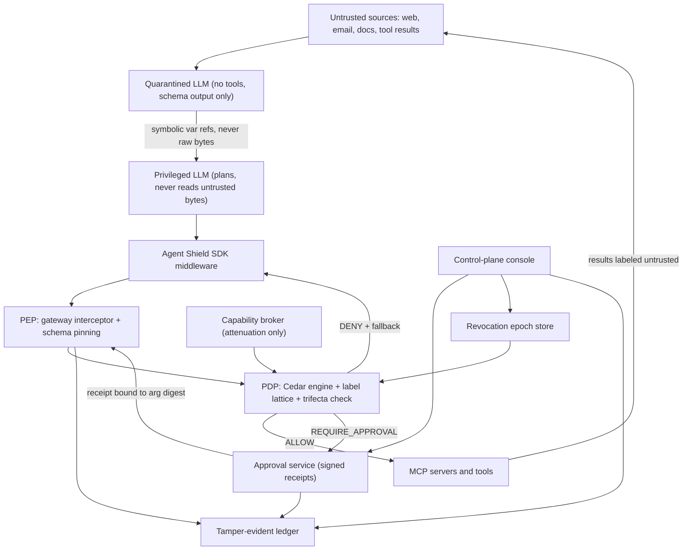

### Decision pipeline

The pipeline runs in a fixed order and stops at the first denial, so no later stage can re-permit an earlier refusal:

1. Resolve principal identity. If identity is unresolvable, deny (fail-closed).
2. Check the revocation epoch. A stale epoch on the session capability means deny.
3. Verify the pinned tool schema digest against what the MCP server currently advertises. A mismatch is a rug-pull and denies.
4. Evaluate the Cedar policy set with the call's typed arguments as action context.
5. Evaluate the information-flow rule against the session's current label ceiling (the most restrictive combination of everything read so far).
6. Evaluate the lethal-trifecta invariant for the session.
7. If a receipt is required, verify the Ed25519 signature, the argument digest, the expiry, and that the nonce is unused.
8. Dispatch, then write the outcome (including "uncertain") to the ledger.

---

## Diagrams

### 2. Data flow diagram

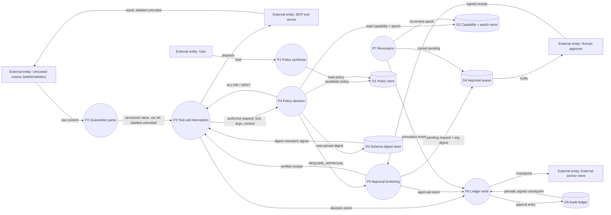

### 3. Decision pipeline flowchart

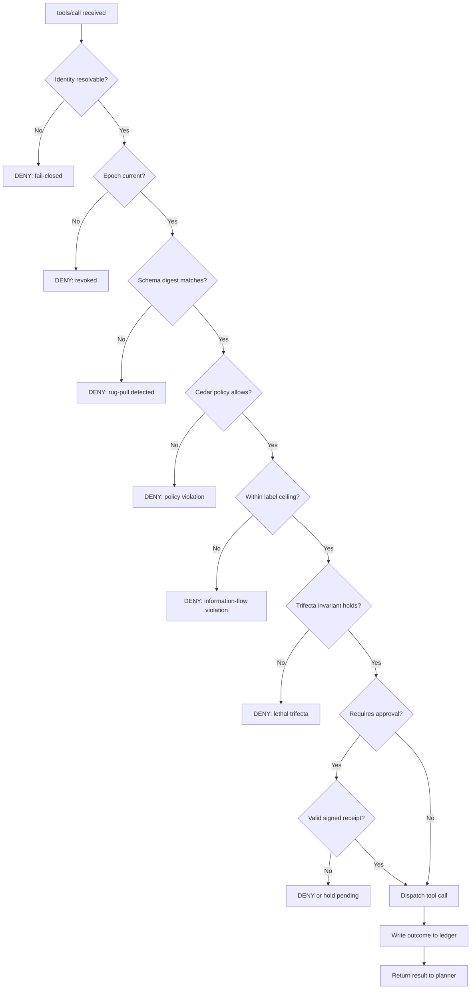

### 4. Sequence diagram — tool-call lifecycle (allow / approval / deny)

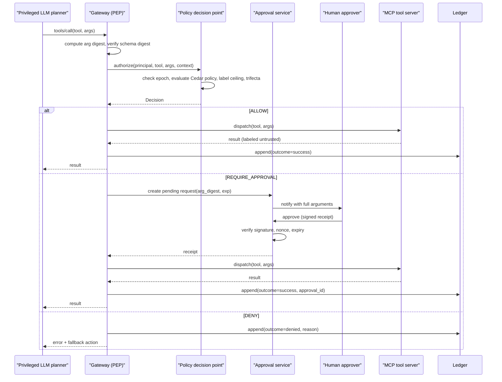

### 5. Sequence diagram — dual-LLM quarantine (CaMeL-style)

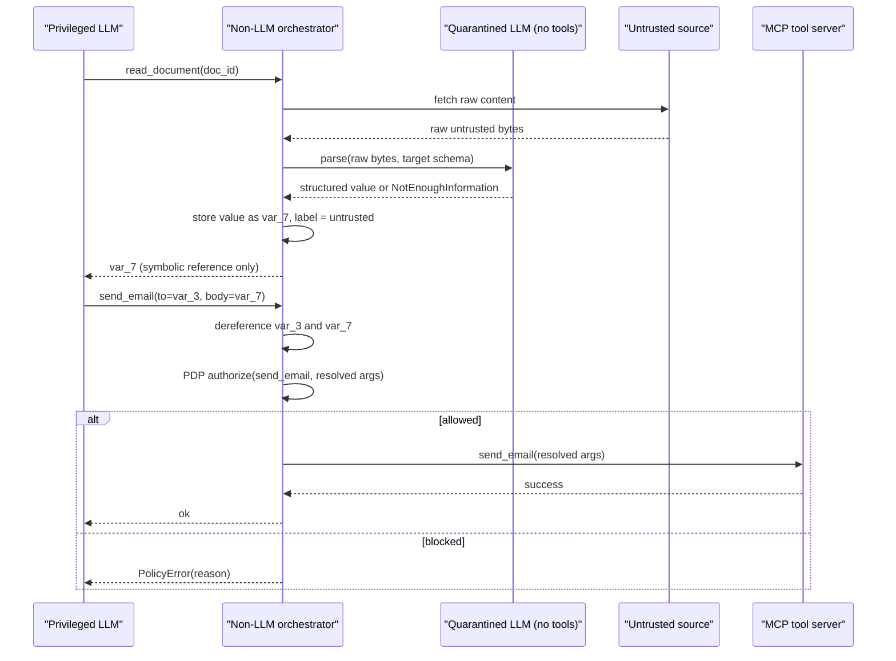

### 6. Sequence diagram — emergency revocation

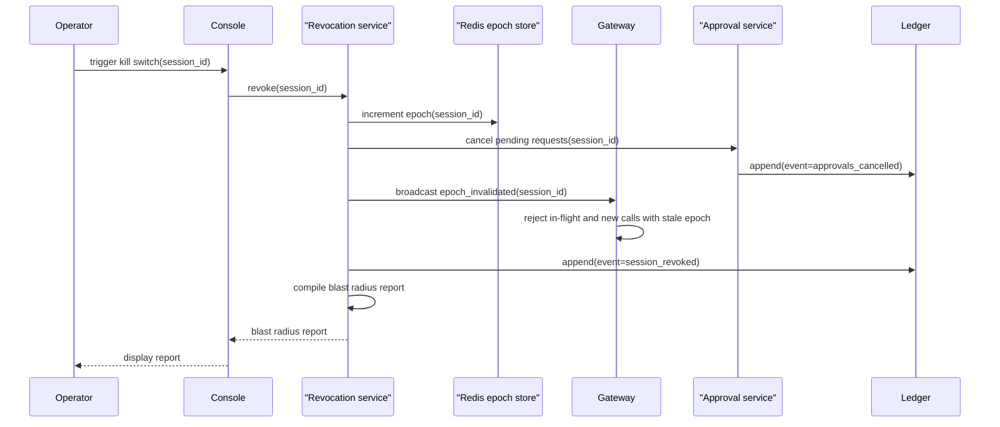

### 7. State diagram — tool-call outcome states

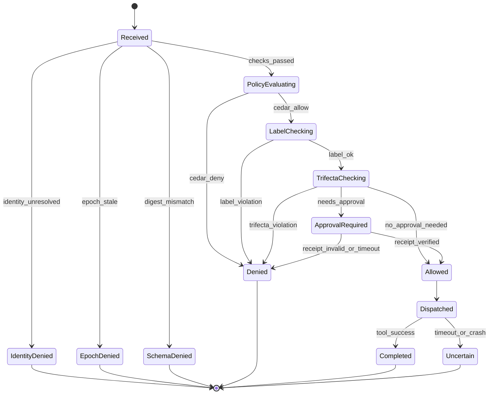

### 8. State diagram — capability lifecycle (monotonic confinement)

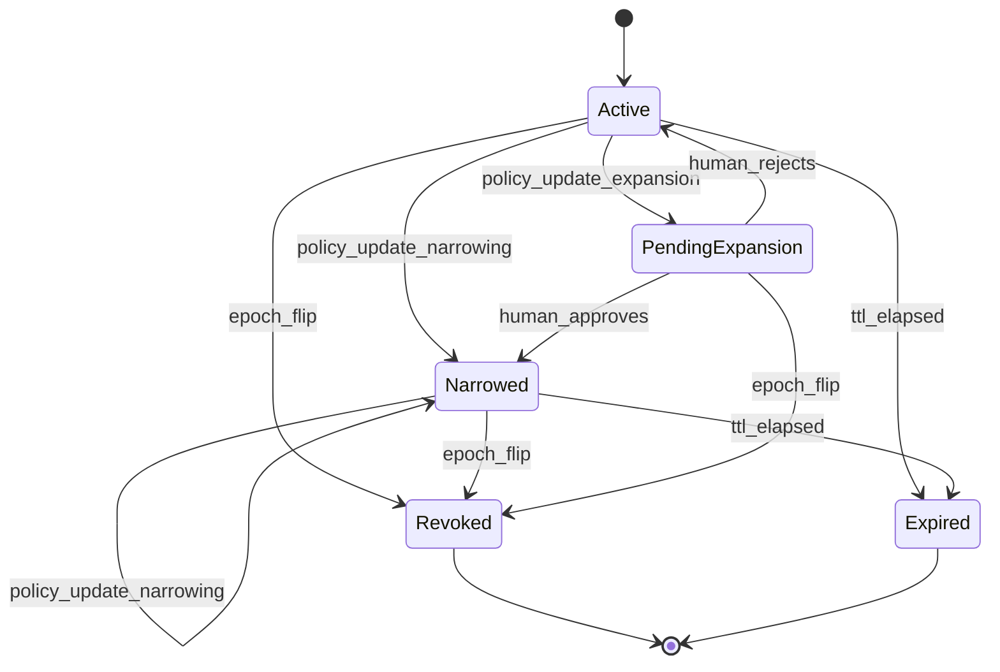

### 9. ER diagram — persistence schema

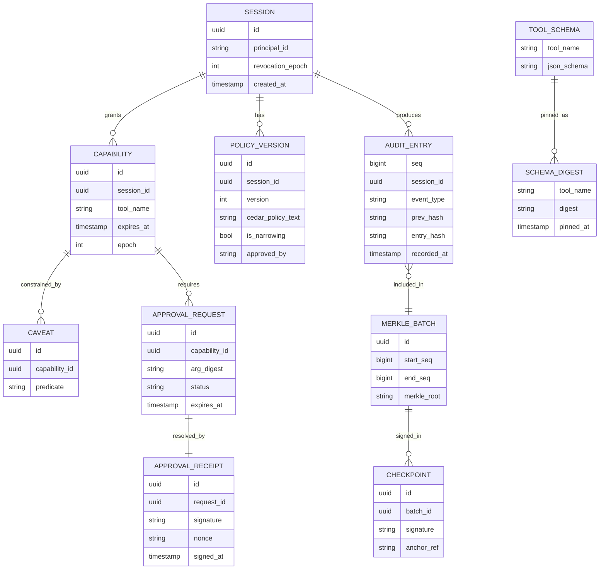

### 10. Class diagram — core domain model

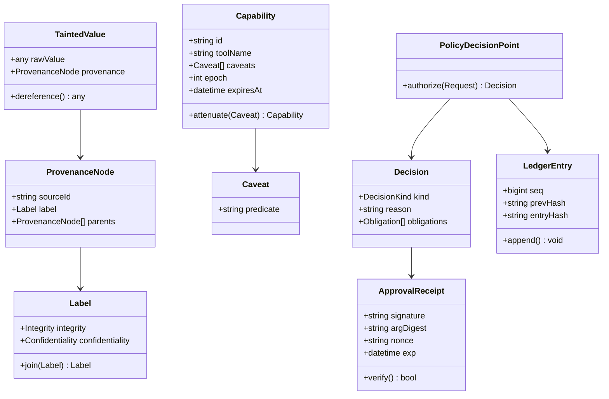

### 11. Component diagram — package dependencies

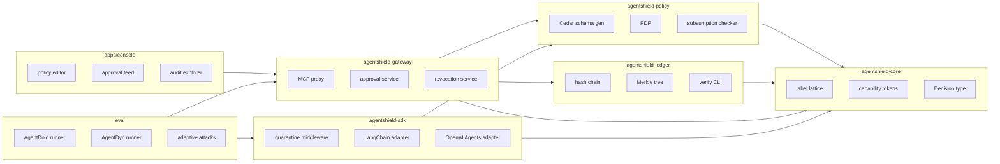

### 12. Deployment diagram

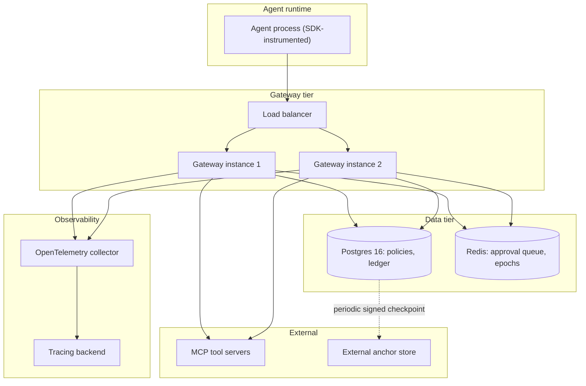

---

## Repository layout

A `uv` workspace monorepo so the core stays pure and independently testable:

- `packages/agentshield-core/` - zero-I/O enforcement primitives: label lattice, provenance DAG, capability tokens, `Decision` type, trifecta invariant. This is the security kernel and should be small enough to review by hand.
- `packages/agentshield-policy/` - Cedar integration: schema generation from MCP tool descriptions, policy loading and validation, subsumption checking for monotonic confinement.
- `packages/agentshield-ledger/` - append-only hash chain, Merkle tree, signed checkpoints, plus a standalone zero-dependency `agentshield-verify` CLI an auditor can run without trusting the server.
- `packages/agentshield-gateway/` - FastAPI plus MCP SDK proxy; the PEP for agents whose code you do not control.
- `packages/agentshield-sdk/` - decorators and middleware for the OpenAI Agents SDK and LangChain; gives per-value label propagation a gateway cannot see.
- `apps/console/` - Next.js control plane.
- `eval/` - AgentDojo and AgentDyn harness plus the adaptive attack suite.
- `docs/threat-model.md` - explicit trust boundaries, assumptions, and non-goals.

---

## Tech stack

### Enforcement core (Python 3.12, `uv`)

- `cedarpy` for the policy engine. Cedar over OPA/Rego deliberately: it is authorization-specific, strongly typed, default-deny by construction, and verification-guided. Parse the policy set once at startup into a reusable `PolicySet` handle rather than re-parsing per call.
- `cedar-policy-mcp-schema-generator` to auto-generate a Cedar schema from an MCP server's `tools/list` response. It emits one Cedar action per tool with the tool's JSON Schema mapped into action context, which is exactly the argument-level granularity the design needs, and it lets Cedar's validator catch policy typos before deploy instead of silently failing at runtime.
- `z3-solver` as the fallback decision procedure for policy subsumption where Cedar's own analysis does not cover the comparison.
- `pydantic` v2 for typed tool arguments and wire contracts; `cryptography` for Ed25519; `rfc8785` for JSON canonicalization so digests are stable.
- FastAPI, `mcp` v2 (speaks the 2026-07-28 spec revision: stateless requests, no initialize handshake, `server/discover`, while still serving 2025-era clients from the same `MCPServer`), SQLAlchemy 2 async, `asyncpg`.

### Storage

- Postgres 16. The audit table is append-only enforced at the grant level: the application role gets `INSERT` and `SELECT` only, with `UPDATE` and `DELETE` revoked. Retention pruning, if any, is itself an audited event that leaves tombstone hashes behind.
- Redis for the pending-approval queue and the revocation epoch counter, which is the hot path for bounded-latency revocation.

### Control plane

- Next.js 15, TypeScript, Tailwind, shadcn/ui, TanStack Query, SSE for the live approval feed.

### Observability

- OpenTelemetry with the GenAI semantic conventions, so Agent Shield spans drop into existing tooling rather than inventing a format: `gen_ai.operation.name=execute_tool`, `gen_ai.tool.name`, `gen_ai.tool.call.id`, correlated by `gen_ai.conversation.id` under an `invoke_agent` parent. Policy decisions attach as span attributes and events.

### Quality gates

- `pytest` plus `hypothesis`. Property-based tests matter unusually much here: the label lattice must be verified to be a genuine lattice (join is associative, commutative, idempotent, monotonic) or the whole information-flow argument is unsound.
- `mypy --strict`, `ruff`, `semgrep`, `pip-audit` in GitHub Actions.

---

## Advanced features that make this stand out

These are the differentiators, roughly in order of how much credit they earn relative to effort.

**1. Monotonic confinement with formal subsumption.** The initial policy is LLM-synthesized from the user's task, but every subsequent policy update must be *proven* to be a narrowing of the current policy before it is auto-applied; expansions require explicit human approval. The session's effective action space can then only shrink without a human in the loop, which means even a fully hijacked planner cannot escalate its own privileges. This is the single strongest property the system can claim.

**2. Dual-LLM quarantine with symbolic dereferencing.** Untrusted tool results never reach the privileged planner as raw bytes. They are stored and replaced with a `var_` handle; the planner manipulates the handle symbolically and can pass it as a tool argument, but a non-LLM orchestrator is what dereferences it at dispatch time. The planner never reads the injected `[SYSTEM OVERRIDE]` text at all, so there is nothing to obey.

**3. Lethal-trifecta invariant as an enforced session property.** Track whether a session has simultaneously acquired untrusted input, access to private data, and an external communication channel. Refusing to let all three co-exist converts a vague best practice into a checkable invariant, and it is a genuinely strong story for high-risk deployments.

**4. Tool-schema pinning and rug-pull detection.** Pin the digest of each tool's advertised schema and description at session start. If an MCP server silently changes a tool description mid-session, that is a supply-chain attack on the agent, and nearly no existing gateway catches it.

**5. Cryptographic approval receipts.** Current gateway implementations mostly show a human the arguments and then grant a time-boxed permission to call the tool. That is replayable and vulnerable to time-of-check-to-time-of-use drift. Bind the receipt instead to an Ed25519 signature over the canonical JSON of `{session, tool, arg_digest, resource_version, nonce, exp}`, make it single-use by recording the nonce, and verify it offline against a pinned public key. Approval then means "this human approved *this exact call*", not "this tool is open for five minutes".

**6. Tamper-evident ledger done correctly.** Hash chain for ordering, Merkle tree with Ed25519-signed checkpoints for logarithmic inclusion and consistency proofs, and periodic anchoring of the root to an append-only store the operator cannot silently rewrite. Two implementation details are easy to get wrong and worth getting right: use RFC 6962 domain separation (`H(0x00 || leaf)` versus `H(0x01 || left || right)`), and promote lone nodes up a level rather than duplicating them, because naive duplication makes `[a,b,c]` and `[a,b,c,c]` collide (CVE-2012-2459) and destroys tamper-evidence exactly where you claimed to prove it.

**7. Bounded-latency emergency revocation.** A global and per-session epoch counter, combined with deliberately short capability TTLs, bounds how long a revoked agent can still act. The kill switch flips the epoch, drains the pending-approval queue, and poisons the session capability set. Crucially, be honest in the design about in-flight calls: you cannot un-send an email, so a dispatched-but-unconfirmed call is recorded as an uncertain outcome and surfaced in a **blast-radius report** listing every action that completed before containment.

**8. Capability attenuation across multi-agent delegation.** A sub-agent receives a derived capability that can only add caveats, never remove them, so a delegated agent provably cannot exceed its parent's privilege.

**9. Adaptive, defense-aware evaluation.** This is where most projects in this space fall down. Every published out-of-band defense was validated only on static benchmarks, and AgentDyn showed in 2026 that nearly all of them are either insufficiently secure or badly over-defensive once tasks become dynamic and open-ended. Report both sides of the trade-off, and include attacks written with knowledge of the defense.

**10. Shadow mode.** Run the full pipeline in log-only mode so a team can see what *would* have been blocked before enforcing. Without this, nobody adopts a default-deny system in production.

**11. Explainable denials and deterministic replay.** Render the provenance path that caused a block ("this argument derives from an untrusted web page read at step 4"), and replay any session from the ledger to reproduce a decision exactly.

**12. Egress and budget controls.** Argument-level secret-pattern scanning, URL allowlisting on outbound tools, and per-capability spend and call quotas.

One explicit non-goal worth stating in the threat model: an injection-detection classifier is included only as a defense-in-depth signal that raises a tool's approval tier. It is never the authoritative decision, because classifier-based detection is precisely what adaptive attackers have repeatedly defeated.

---

## Evaluation plan

- Integrate the core as an AgentDojo `BasePipelineElement` and run `benchmark_suite_with_injections` across the Workspace, Slack, Travel, and Banking suites. Report the three standard metrics: benign utility, utility under attack, and targeted attack success rate.
- Add AgentDyn's 60 open-ended tasks and 560 injection cases to measure **over-defense**, which static benchmarks hide entirely.
- Write a defense-aware adaptive attack suite that knows the architecture and specifically targets the policy synthesizer, the quarantined parser's schema, and the approval UI (for example, arguments crafted to look benign to a human reviewer).
- Publish an ablation showing the marginal contribution of each pillar, since that is what tells a reader which mechanisms are actually carrying the defense.

---

## Implementation roadmap

Ordered so that the security kernel and its tests exist before anything depends on them, and so there is a demonstrable end-to-end path (gateway blocking a real injection) well before the console and eval work. Each task below is small enough to be a single PR.

### Phase 1 — Foundations

**1.1 Scaffold**

- [ ] Initialize the `uv` workspace (`pyproject.toml` with `[tool.uv.workspace] members`), one empty package per module in `packages/`
- [ ] Write `docker-compose.yml`: Postgres 16, Redis, with named volumes and healthchecks
- [ ] Add `ruff`, `mypy --strict`, `pytest`, `hypothesis` as dev dependencies with baseline configs
- [ ] Set up pre-commit hooks (ruff format + lint, mypy, trailing whitespace)
- [ ] Write the GitHub Actions CI workflow: lint, type-check, test, `semgrep`, `pip-audit`, on every PR
- [ ] Write `docs/threat-model.md`: trust boundaries (who can supply untrusted input, who holds signing keys, what the operator is and is not trusted to do), explicit assumptions, and non-goals (classifier-based detection is defense-in-depth only, not authoritative)
- [ ] Write root `README.md` with the architecture diagram and a "quickstart" stub

**1.2 Core lattice (`agentshield-core`)**

- [ ] Define `Integrity` (untrusted / tentative / trusted) and `Confidentiality` (public / internal / private / secret) enums
- [ ] Implement `Label` with `join` (least upper bound) and `meet`, plus `__le__` for the partial order
- [ ] Write hypothesis property tests proving `join` is associative, commutative, idempotent, and monotonic (this is the correctness proof for every later information-flow check)
- [ ] Implement `ProvenanceNode` (source id, label, parent links) and the `TaintedValue` wrapper
- [ ] Implement the `Decision` type: `ALLOW` / `DENY` / `REQUIRE_APPROVAL`, with `reason` and a list of `Obligation`
- [ ] Implement the lethal-trifecta session tracker: three booleans (untrusted-input-seen, private-data-accessed, external-channel-used) with a `would_complete_trifecta(action)` check
- [ ] Unit-test trifecta transitions, including the order-independence of acquiring the three properties
- [ ] Finalize public API (`__init__.py` exports) and publish-ready `pyproject.toml`

**1.3 Capabilities**

- [ ] Design the capability token schema: id, session id, tool name, caveats, epoch, `expires_at`
- [ ] Implement a small caveat predicate language (attribute equality/range constraints over tool arguments)
- [ ] Implement `attenuate(caveat)`: returns a new capability that is a strict subset of the original, append-only
- [ ] Implement capability derivation for sub-agent delegation (derived capability inherits all parent caveats)
- [ ] Enforce TTL and bind each capability to the epoch it was minted under
- [ ] Property tests: for any sequence of attenuations, the effective permission set never grows
- [ ] Implement signing/serialization (so a capability can be handed to a gateway and verified without a DB round trip)

### Phase 2 — Enforcement

**2.1 Policy engine (`agentshield-policy`)**

- [ ] Write the Cedar schema stub (`@mcp_principal`, `@mcp_resource`, `@mcp_context` entity declarations)
- [ ] Integrate `cedar-policy-mcp-schema-generator` to turn an MCP `tools/list` response into a full Cedar schema
- [ ] Implement the policy loader: parse policy text, validate against the generated schema, surface validation errors
- [ ] Wrap `cedarpy.is_authorized` behind a cached `PolicySet` handle (parse once at startup/reload, not per call)
- [ ] Implement the `PDP.authorize(request) -> Decision` interface
- [ ] Make every failure mode (parse error, schema mismatch, engine exception) resolve to `DENY` — fail-closed by construction
- [ ] Write unit tests covering allow rules, forbid overrides, and argument-level constraints
- [ ] Implement a first-pass subsumption check (set containment over allow rules) as a placeholder ahead of the Z3-backed version in Phase 4

**2.2 Ledger (`agentshield-ledger`)**

- [ ] Implement RFC 8785 JSON canonicalization for ledger entries
- [ ] Implement the hash chain: `entry_hash = H(prev_hash || canonical(entry))`
- [ ] Implement the Merkle tree builder with RFC 6962 domain separation (`H(0x00 || leaf)` vs `H(0x01 || left || right)`) and promote-not-duplicate for odd node counts
- [ ] Implement inclusion-proof and consistency-proof generation and verification
- [ ] Implement Ed25519 checkpoint signing over `{merkle_root, tree_size, prev_checkpoint_hash, timestamp}`
- [ ] Implement a periodic anchoring job that publishes checkpoints to an external append-only store
- [ ] Build the standalone zero-dependency `agentshield-verify` CLI that checks a ledger export against a pinned public key, offline
- [ ] Write the Postgres migration for `audit_entry`, `merkle_batch`, `checkpoint`; grant the app role `INSERT, SELECT` only, revoke `UPDATE, DELETE`
- [ ] Regression test for CVE-2012-2459: assert `[a,b,c]` and `[a,b,c,c]` produce different roots
- [ ] Tamper tests: mutate one historical entry and confirm both the hash chain and the Merkle root detect it

**2.3 Gateway (`agentshield-gateway`)**

- [ ] Scaffold the FastAPI app and wire up the `mcp` v2 server/proxy for Streamable HTTP
- [ ] Implement `tools/list` interception: fetch upstream tool descriptions, compute and store a schema digest per tool, pin it to the session
- [ ] Implement `tools/call` interception running the full 8-step decision pipeline in order
- [ ] Implement rug-pull detection: recompute the digest on every call and deny on mismatch
- [ ] Implement dispatch to the upstream MCP tool server on `ALLOW`
- [ ] Implement outcome recording, including an explicit `UNCERTAIN` outcome for timeouts/crashes mid-dispatch
- [ ] Write integration tests against a mock MCP server covering allow, deny, and schema-mismatch paths
- [ ] Write a basic concurrency/load test to confirm the pipeline is safe under parallel calls on the same session

### Phase 3 — Human control

**3.1 Approvals**

- [ ] Define the receipt payload: `{session, tool, arg_digest, resource_version, nonce, exp}`
- [ ] Implement Ed25519 sign/verify helpers, keyed off a pinned operator public key
- [ ] Implement the Redis-backed pending-approval queue (create, list, resolve)
- [ ] Implement single-use nonce enforcement via `SETNX`
- [ ] Implement approval tiering: map tool/consequence to a required reviewer tier
- [ ] Implement expiry handling: an unresolved request past `exp` resolves to deny, not a silent hang
- [ ] Build the approval API: create pending, list pending, approve, reject, each writing to the ledger
- [ ] Tests: replayed receipt is rejected, expired receipt is rejected, mismatched argument digest is rejected, tiering routes correctly

**3.2 Revocation**

- [ ] Implement global and per-session epoch counters in Redis
- [ ] Wire the epoch check into decision-pipeline step 2
- [ ] Implement the kill-switch endpoint: increment the epoch, cancel all pending approvals for the session
- [ ] Implement short capability TTLs so a missed epoch check still self-expires quickly
- [ ] Implement the blast-radius report generator: query the ledger for every action that completed between the trigger and full epoch propagation
- [ ] Tests: an in-flight call is rejected immediately after revoke, and the blast-radius report matches the ledger exactly

### Phase 4 — Depth

**4.1 SDK and quarantine (`agentshield-sdk`)**

- [ ] Define the adapter interface (`before_tool_call`, `after_tool_result`) that both framework adapters implement
- [ ] Build the OpenAI Agents SDK adapter
- [ ] Build the LangChain adapter
- [ ] Implement the `var_` handle registry: untrusted tool results are stored and replaced with a symbolic reference
- [ ] Implement the quarantined LLM wrapper: structured-output-only, zero tool bindings, returns `have_enough_information: bool`
- [ ] Implement orchestrator-side dereferencing: `var_` handles are resolved to real values only at tool-dispatch time, never shown to the planner
- [ ] Implement per-value label propagation through both adapters so labels survive framework-specific message passing
- [ ] End-to-end test: inject a `[SYSTEM OVERRIDE]` string into a tool result and assert the planner's context never contains the raw string

**4.2 Monotonic confinement**

- [ ] Implement initial policy synthesis: user task in, candidate Cedar policy out, via a constrained prompt
- [ ] Define the policy-update proposal format (a diff against the current policy)
- [ ] Implement the subsumption checker: Cedar analysis first, `z3-solver` fallback for cases Cedar's analyzer doesn't cover
- [ ] Classify each proposed update as narrowing (auto-apply) or expansion (route to approval)
- [ ] Wire the expansion path into the Phase 3 approval service
- [ ] Tests: a narrowing update applies without a human; an expansion is blocked until approved; an adversarially-crafted "narrowing" that actually expands scope is caught and rejected

**4.3 Observability**

- [ ] Set up the OpenTelemetry SDK and exporter configuration
- [ ] Instrument `invoke_agent` and `execute_tool` spans per the GenAI semantic conventions
- [ ] Attach policy decisions (allow/deny/approval, reason) as span attributes and events
- [ ] Implement shadow mode: run the full pipeline, log every decision, never actually block
- [ ] Build baseline dashboards/alerts: deny rate, approval latency, repeated-tool retry-loop detection

### Phase 5 — Surface and proof

**5.1 Console**

- [ ] Scaffold the Next.js app with auth and the base layout
- [ ] Build the policy editor with live Cedar validation against the session schema
- [ ] Build the live approval queue over SSE, showing full arguments and the provenance path
- [ ] Build the audit explorer with human-readable denial explanations ("this argument derives from an untrusted page read at step 4")
- [ ] Build deterministic session replay from the ledger
- [ ] Build the kill-switch control and the blast-radius report view

**5.2 Eval**

- [ ] Wrap the gateway as an AgentDojo `BasePipelineElement`
- [ ] Run `benchmark_suite_with_injections` across Workspace, Slack, Travel, and Banking; collect benign utility, utility under attack, and targeted ASR
- [ ] Integrate AgentDyn's open-ended tasks to measure over-defense
- [ ] Write the defense-aware adaptive attack suite: attacks that target the policy synthesizer, the quarantined parser's schema, and the approval reviewer directly
- [ ] Build the per-pillar ablation harness (toggle each pillar off, re-run, compare) and publish the report

**5.3 Harden**

- [ ] Implement egress secret-pattern scanning over tool arguments
- [ ] Implement URL allowlisting for outbound tools
- [ ] Implement per-capability spend and call-count quotas
- [ ] Run failure-injection tests specifically on the fail-closed paths (DB down, Redis down, Cedar engine throwing)
- [ ] Write the Helm chart and Kubernetes manifests
- [ ] Set up signed releases (artifact signing, SBOM)
- [ ] Write deployment and operator documentation

---

## Honest risks

- **Over-defense is the real failure mode.** A default-deny system that blocks legitimate work gets turned off. Budget serious time for the fallback-action design and for shadow mode.
- **The policy synthesizer is the soft spot.** It is an LLM reading the user's task. Monotonic confinement contains the damage but does not eliminate it; the initial policy still needs a review path for high-risk sessions.
- **Human approval fatigue.** If everything needs approval, approvals become rubber stamps. Tier them by consequence and make the denial explanation good enough that reviewers stay engaged.

---

## References

### Defense architectures

- [Progent: Securing AI Agents with Privilege Control](https://arxiv.org/html/2504.11703) - symbolic privilege policies over tool names and typed arguments; monotonic confinement via SMT-checked policy updates.
- [Defeating Prompt Injections by Design (CaMeL)](https://arxiv.org/html/2503.18813v2) - Google DeepMind / ETH Zurich; first concrete dual-LLM implementation with a provenance-tracking interpreter. [Code](https://github.com/google-research/camel-prompt-injection).
- [FIDES in Microsoft Agent Framework](https://devblogs.microsoft.com/agent-framework/fides/) - information-flow control as agent middleware, with label propagation and `approval_on_violation`.
- [Design Patterns for Securing LLM Agents against Prompt Injections](https://arxiv.org/html/2506.08837v3) - taxonomy including the dual-LLM, map-reduce, and plan-then-execute patterns.
- [Architecting Secure AI Agents](https://arxiv.org/abs/2603.30016v1) - position paper on when a learned model may participate in a security decision, and how to constrain what it observes.

### Evaluation

- [AgentDojo](https://agentdojo.spylab.ai/) - `pip install agentdojo`; four suites, 74 tools; benign utility / utility under attack / targeted ASR.
- [AgentDyn](https://arxiv.org/pdf/2602.03117) - 60 open-ended dynamic tasks and 560 injection cases; shows existing defenses are insecure or over-defensive. [Code](https://github.com/leolee99/AgentDyn).
- [Adaptive Evaluation of Out-of-Band Defenses](https://arxiv.org/html/2606.26479v1) - organizes these defenses as Biba integrity, reference monitoring, and least privilege; specifies the adaptive-attack protocol.

### Primitives and tooling

- [MCP specification 2026-07-28](https://modelcontextprotocol.io/specification/latest) and the [Python SDK v2](https://github.com/modelcontextprotocol/python-sdk).
- [Cedar for Agents](https://github.com/cedar-policy/cedar-for-agents) - MCP tool schema generator and analysis crates; [`cedarpy`](https://pypi.org/project/cedarpy/) for Python.
- [RFC 6962 (Certificate Transparency)](https://datatracker.ietf.org/doc/html/rfc6962.html) - Merkle tree hashing, domain separation, inclusion and consistency proofs.
- [Tamper-Evident Audit Logs](https://zatona.dev/blog/tamper-evident-audit-logs) - what hash chains, signed checkpoints, and external anchors each actually prove, and to whom.
- [OpenTelemetry GenAI agent spans](https://github.com/open-telemetry/semantic-conventions-genai/blob/main/docs/gen-ai/gen-ai-agent-spans.md) - `invoke_agent`, `invoke_workflow`, `execute_tool`.
- [Frontier Model Forum: Emerging Security Practices for AI Agents](https://www.frontiermodelforum.org/issue-briefs/emerging-security-practices-for-ai-agents/) - the lethal-trifecta framing.
